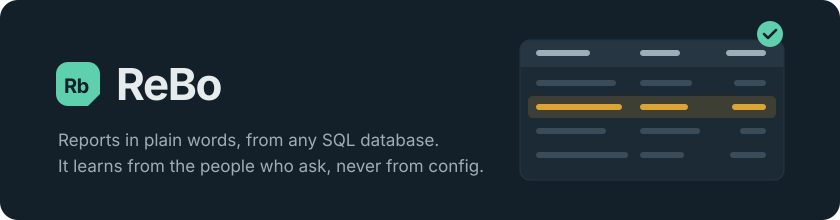
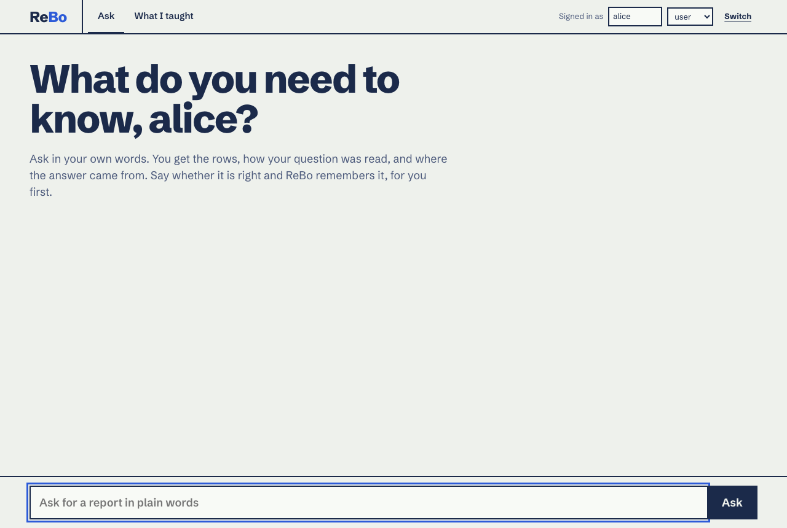
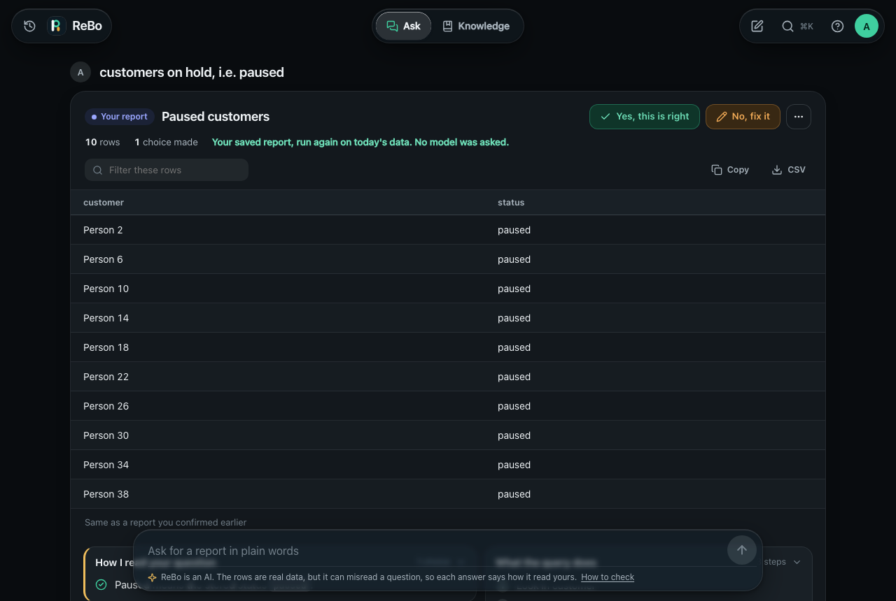
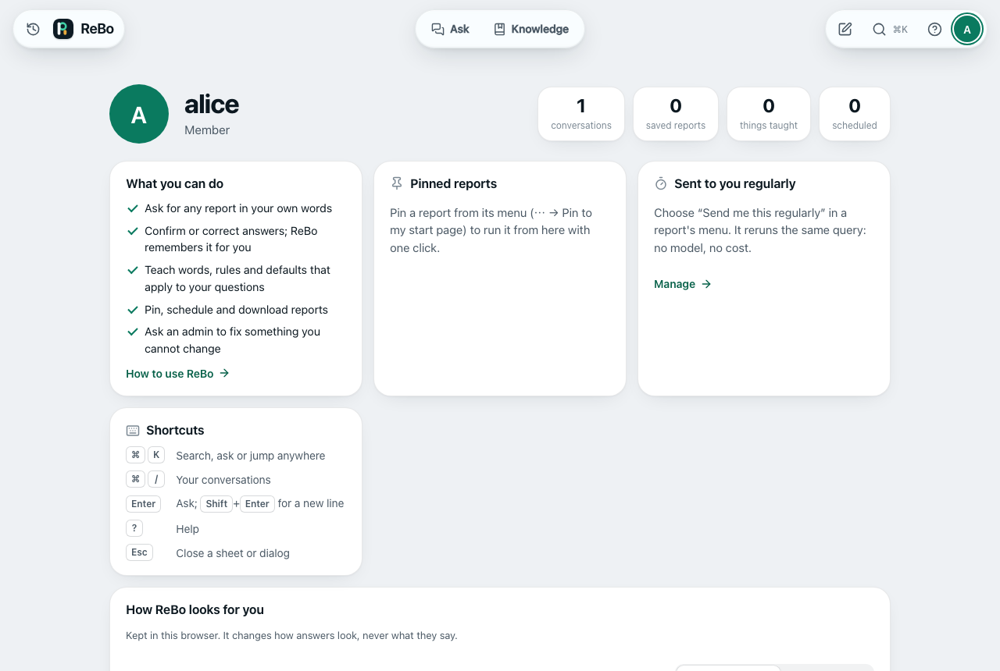
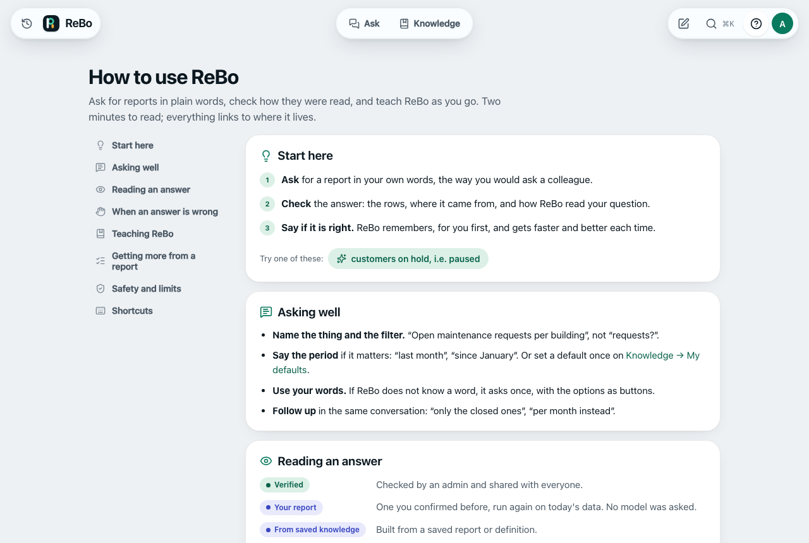
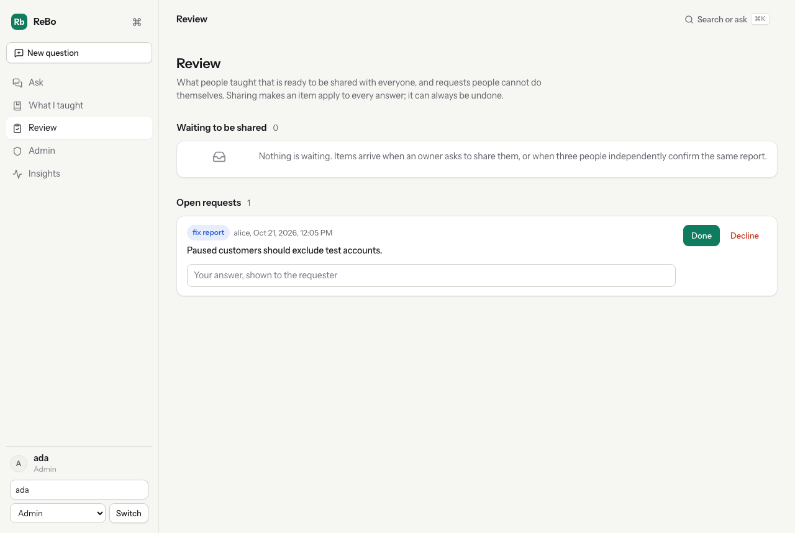
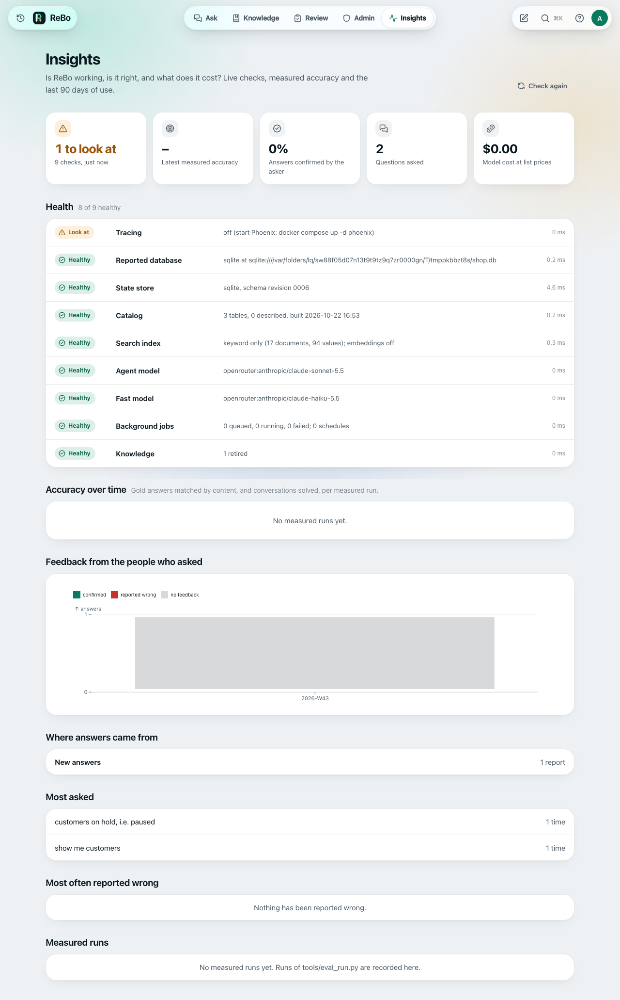
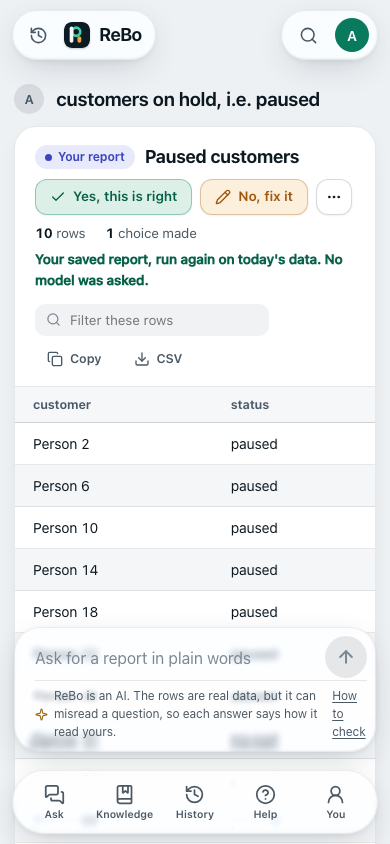
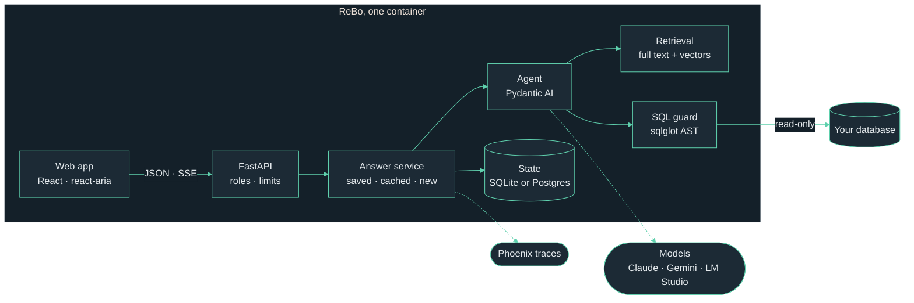
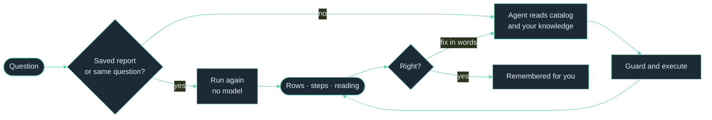

<p align="center">
  
</p>

<p align="center">
  <b>A self-learning reports bot for any SQL database.</b><br>
  Ask in plain words; get one read-only query, the rows, and how your question was read.
  It learns from the people who use it, not from configuration, so it gets more accurate the more your team uses it.
</p>

<p align="center">
  
  
  
  
  
  
</p>

---

## A look inside

<p align="center">
  <br>
  <sub><i>An answer: the rows first, then where it came from, what the query does, and how the question was read.</i></sub>
</p>

<table>
  <tr>
    <td width="50%" align="center">
      <br>
      <sub><i>Start: Liquid Glass bar and composer, known reports, the AI notice in plain words.</i></sub>
    </td>
    <td width="50%" align="center">
      <br>
      <sub><i>Dark mode: the same glass, solid readable content underneath.</i></sub>
    </td>
  </tr>
  <tr>
    <td width="50%" align="center">
      <br>
      <sub><i>You: role, pinned and scheduled reports, shortcuts, how ReBo looks for you.</i></sub>
    </td>
    <td width="50%" align="center">
      <br>
      <sub><i>Help: every feature in short sections, with links and "Try it" questions.</i></sub>
    </td>
  </tr>
  <tr>
    <td width="50%" align="center">
      <br>
      <sub><i>Review: what people agree on, waiting for an admin to share it with everyone.</i></sub>
    </td>
    <td width="50%" align="center">
      <br>
      <sub><i>Insights: live health checks, measured accuracy, feedback and cost.</i></sub>
    </td>
  </tr>
</table>

<p align="center"><b>On a phone</b></p>

<p align="center">
  <br>
  <sub><i>The same answer, in a drawer layout.</i></sub>
</p>

---

## What ReBo is

Point ReBo at a database. It reads the structure, statistics and stored values (`rebo bootstrap`)
and needs nothing else about your domain: no semantic layer, no glossary, no per-customer prompt.
People ask for reports in their own words. Every answer is executed before it is shown, says where it
came from, and lists how the question was read, so people can check it without reading SQL.

When someone confirms an answer or corrects it in words, ReBo remembers it **for that person** at
once. It reaches everyone only when three people independently agree and an admin approves, or when
an admin adds it directly. Nothing is ever deleted: every piece of learned knowledge has a history
and can be undone.

## Features

| Area | What you get |
|------|--------------|
| **Design** | Liquid Glass navigation (per-element lensing, pointer-lit rims, scroll-edge blur) over solid, readable content; light and dark; a Help page and a You page. [doc 25](docs/25-brand-and-design.md) |
| **Asking** | Plain-language questions, live progress, sortable results, CSV, follow-up chips, one clarification when a question has two readings, answers rendered as Markdown. |
| **Checking an answer** | A trust label (verified, yours, from saved knowledge, new), "What the query does" as plain steps generated from the query itself, "How I read your question", and the query on demand. |
| **Learning** | Confirm or fix in words; "Remember this?" notes; personal defaults; terms, rules and joins taught in the chat. Personal first, shared by evidence. |
| **Reuse at no cost** | Saved reports and repeat questions are rerun on today's data with no model call; new values are filled into saved queries; scheduled reports; pins; drill into the rows behind a number. |
| **Roles** | Users ask and teach for themselves; admins review, share, edit and undo any knowledge; owners change the ~20-line configuration with validation, history and rollback. |
| **Safety** | Read-only by construction: a sqlglot syntax-tree guard, read-only session and user, timeouts, protected columns detected at bootstrap, per-user rate and cost limits. |
| **Insights** | Health checks, accuracy over measured runs, confirmation rate, cost, most asked and most rejected, with every answer traced in Phoenix and people's feedback attached to the trace. |
| **Integrations** | JSON API, AG-UI event stream, MCP server, a host adapter (the JMS chat contract), webhooks for stale knowledge and requests. |

## How it's built

One Python service that also serves the web app. State lives in SQLite or Postgres (+ pgvector);
the reported database is only ever read.



## A question's path

The cheapest route that can answer wins; a model is asked only when nothing saved fits.



## How learning spreads


## Quick start

```bash
uv sync --all-extras                        # Python 3.13, everything incl. tracing
cp rebo.example.yaml rebo.yaml              # the whole configuration (about 20 values)
cp .env.example .env                        # API keys only (OpenRouter is enough)
(cd web && npm ci && npm run build)         # the web app
uv run rebo bootstrap --describe            # learn the database
uv run rebo serve                           # http://127.0.0.1:8080
```

No database at hand? Build the made-up demo with `uv run python fixtures/demo_property/build.py`, then
prefix the last two commands with `REBO_CONFIG=fixtures/demo_property/rebo.yaml`. Traces: `docker
compose up -d phoenix` (picked up automatically). Production: `docker compose -f compose.prod.yml up
-d` (bot, Postgres + pgvector, login proxy, Phoenix); see [OPERATIONS.md](OPERATIONS.md).

## Measured

Claims cite a results file (`fixtures/*/eval_results_*.json`); details in [docs/20](docs/20-llm-providers.md).

| Set | Model | Result |
|-----|-------|--------|
| Made-up demo domain, 10 gold reports, empty knowledge | Claude Sonnet 5.5 | 8/10 content match |
| Same | Gemini 3.5 Flash-Lite, free tier | 7/10 at $0 |
| 18 product-owner prompts on a JMS-shaped database | Claude Sonnet 5.5 | 13 reports, 5 justified clarifications, 0 errors |
| Same | Haiku → Sonnet cascade | 5.7× cheaper, one grain error |
| Repeat of a confirmed question | any | answered in seconds with 0 model calls |

## Documentation

| Guide | For |
|-------|-----|
| [AGENTS.md](AGENTS.md) | Direction and the rules that do not change. Read first. |
| [Documentation index](docs/README.md) | Every design document, in reading order. |
| [Architecture](docs/02-architecture.md) | Components, file map, one turn end to end. |
| [Learning and trust](docs/05-learning-and-trust.md) | How knowledge is learned, shared, made stale and undone. |
| [SQL safety](docs/07-sql-safety.md) | The walls between a question and a write. |
| [Web app and API](docs/10-api-and-ui.md) | Every route, the UI, design decisions. |
| [Brand and design](docs/25-brand-and-design.md) | The mark, colours, voice, Liquid Glass. |
| [Evals and observability](docs/11-evals-and-observability.md) | How accuracy is measured and traced. |
| [Operations](OPERATIONS.md) | Day-to-day running: start, back up, upgrade, roles. |
| [Contributing](CONTRIBUTING.md) | Checks, evals, commit rules. |
| [Security](SECURITY.md) | What the code guarantees and how to report a problem. |

## Stack

| Layer | Choice |
|-------|--------|
| Agent | **Pydantic AI 2** with Claude (OpenRouter or Anthropic), Gemini, OpenAI or LM Studio |
| SQL | **sqlglot** syntax-tree guard, **SQLAlchemy** for MySQL, Postgres, SQLite and others |
| Retrieval | SQLite FTS5 or Postgres full text, **fastembed** or LM Studio embeddings, **pgvector**, reciprocal rank fusion |
| Server | **FastAPI**, AG-UI events, MCP, lease-based background jobs |
| State | **SQLite** or **Postgres**, Alembic migrations run at start-up |
| Web app | **React 19**, Liquid Glass (SVG lensing), react-aria-components, TanStack Query, Observable Plot, cmdk, react-markdown |
| Observability | **Arize Phoenix** over OpenTelemetry, feedback and eval verdicts as trace annotations |
| Login | **oauth2-proxy** with any OIDC provider (Pocket ID example in `deploy/auth/`) |

## Maintainer

Built and run by **Akshay Bajpai**.

- Website: https://www.akshaybajpai.com
- Project: https://ghosthub.in
- GitHub: https://github.com/ax5hay
