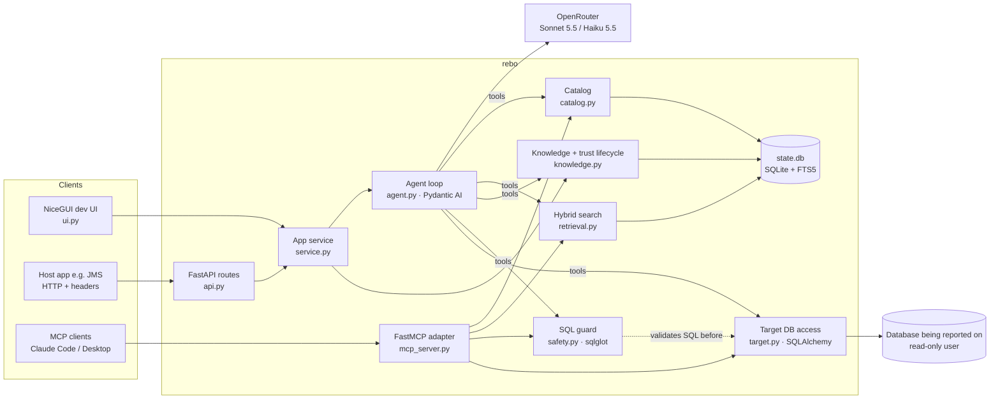
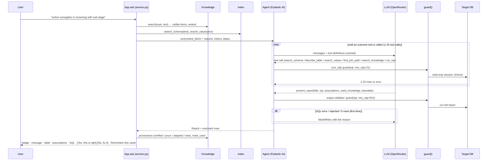

# 02 · Architecture

## 1. Components



| File | Responsibility | Key public names |
|---|---|---|
| `settings.py` | Environment settings (wiring + limits only) | `Settings`, `get_settings()` |
| `store.py` | SQLite state file, schema DDL, transactions | `Store`, `SCHEMA`, `new_id`, `now` |
| `target.py` | Read-only execution, introspection, profiling of the target DB | `TargetDB.run`, `.introspect`, `.profile_table`, `.containment` |
| `safety.py` | SQL guard on the syntax tree; canonical hashing | `guard()`, `GuardError`, `canonical_hash()`, `tables_in()` |
| `catalog.py` | Bootstrap pipeline + read side (describe, join paths) | `bootstrap()`, `Catalog` |
| `retrieval.py` | FTS5 query building, embeddings, RRF fusion | `Index`, `Embedder`, `rrf()`, `fts_query()` |
| `knowledge.py` | Learned items and the trust state machine | `Knowledge`, `User`, `Outcome` |
| `agent.py` | Pydantic AI agent, 6 tools, 3 outcome types, output validator | `build_agent()`, `Report`, `Clarify`, `Reply`, `Learnable`, `Deps` |
| `service.py` | Orchestrates a turn, feedback, teaching, sharing | `App` |
| `messages.py` | Every user-facing sentence | `MESSAGES`, `say()` |
| `api.py` | HTTP routes for host apps | `create_app()`, `router()` |
| `ui.py` | Chat / knowledge / review pages | `mount_ui()` |
| `mcp_server.py` | Optional MCP exposure of read-only tools | `serve_mcp()` |
| `evals.py` | pydantic-evals runner and evaluators | `run_eval()`, `export_confirmed()` |
| `cli.py` | `rebo bootstrap / serve / ask / revalidate / eval / mcp / knowledge / config` | `main()` |
| `llm.py` | Model registry: openrouter / anthropic / google / lmstudio / openai, fallback | `build_model()`, `parse()` |
| `admin.py` | Owner configuration editing (audit, rollback); admin knowledge export/import | `save_config()`, `export_knowledge()`, `import_knowledge()` |
| `adapters/jms.py` | Optional JMS chat contract (`adapters: [jms]`) | `router()`, `to_jms()` |

Outside `src/`:

| Path | What |
|---|---|
| `tools/snapshot/snapshot.py` | Captures any MySQL database's structure + statistics (no rows) |
| `tools/synth/synth.py` | Fills a structure-only MySQL database with synthetic rows from the profile |
| `tools/localdb/` | Read-only user for the local test DB |
| `fixtures/jms_staging/` | JMS staging snapshot (`schema.sql`, `profile.json`, `manifest.json`) + `eval.jsonl` |
| `docker-compose.yml` | MySQL 8.0.44 test DB (+ optional bot container) |

## 2. One user turn, end to end



Feedback is a separate call, with no LLM involved:

```
POST /api/turns/{turn_id}/feedback {"verdict":"correct"}
  → Knowledge.confirm_report → create or reinforce a personal example
  → maybe auto-propose (3 distinct people; same normalised SQL or same result rows)
  → message "Thanks, saved ... This only tunes the bot for you ..."

POST /api/turns/{turn_id}/feedback {"verdict":"wrong","note":"..."}
  → Knowledge.reject(items that the answer was built from)
  → message + "What should be different?"  → user's next message is sent as
    "Correction to the previous report: <text>" in the same conversation
  → the agent revises; anything general the user stated comes back as a learnable
    → "Should I remember this for next time?" card → POST /api/suggestions/{id}
```

## 3. Process model and concurrency

- One Python process: Uvicorn → FastAPI → NiceGUI pages and `/api/*` routes share one `App`.
- `App.ask` is `async`. Pydantic AI runs the synchronous tools (DB calls) in a worker thread, so
  the event loop is never blocked by a slow query.
- `Store` keeps one SQLite connection per thread; WAL mode lets readers run while one writer
  commits. All writes go through `Store.tx()`.
- `TargetDB` uses a SQLAlchemy pool (`pool_pre_ping`, `pool_recycle=1800`). Every query borrows a
  raw DBAPI connection, sets the session read-only plus a timeout, runs, then rolls back and returns
  the connection.
- Bootstrap profiles tables on 4 threads and drafts descriptions on 8 threads.

## 4. State and what is rebuilt

| State | Where | Rebuilt by bootstrap? | Backed up? |
|---|---|---|---|
| Catalog (`cat_*`, `schema_fts`, `value_fts`, `embedding schema:*`) | `state.db` | Yes, fully | Not needed |
| Learned joins in `cat_join` (`source='learned'`) | `state.db` | Kept | Yes |
| Knowledge, events, suggestions | `state.db` | Never touched | **Yes, this is the product's memory** |
| Conversations, turns | `state.db` | Never touched | Optional (audit) |

The knowledge tables are the only state that cannot be rebuilt. Back up `state.db` (doc 13 §4).

## 5. Why these technologies (short; full sources in doc 16)

| Need | Choice | Rejected alternatives |
|---|---|---|
| Agent loop | **Pydantic AI 2.58**: typed tool outputs, output validators with retry, usage limits, OpenRouter prompt caching, test models, pydantic-evals | OpenAI Agents SDK (non-OpenAI models are "best-effort beta"), LangGraph (heavier; its own SQL-agent tutorial says "not for production"), Claude Agent SDK (drives the Claude Code CLI; overkill), raw loop (re-implements retries and validation) |
| SQL parsing | **sqlglot 30.24**: AST, 30+ dialects, `qualify` validates every column | Regexes (what both previous bots used) |
| Memory | **Own tables in SQLite**, borrowing Graphiti's "close, don't delete" and Snowflake / Databricks / ThoughtSpot trust models | Mem0 (append-only, no notion of verified SQL), Letta (whole runtime), LangMem (stalled), Vanna (archived 2026) |
| Search | **SQLite FTS5 (BM25) + fastembed `snowflake-arctic-embed-s` + RRF** | DuckDB VSS (experimental, can corrupt), Qdrant local (dev-only), pgvector (needs a server) |
| UI | **NiceGUI 3.18** (FastAPI underneath, one process) | Chainlit (repo archived 2026-10-15), Streamlit (rerun model fights buttons) |
| Packaging | **uv** lockfile, Python 3.13 | — |
