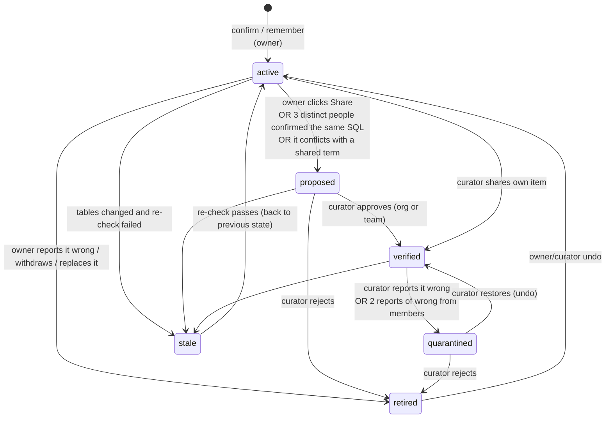

# 05 · Learning and trust

This is the part that replaces every YAML file the previous bots had. Code: `src/rebo/knowledge.py`
(state machine), `service.py` (`feedback`, `remember`, `share`, `promote`, `retire`, `restore`,
`_provenance`), and the `knowledge`, `knowledge_event` and `suggestion` tables (doc 09).

## 1. What the bot learns

| Kind | Created when | Fields that matter | How it is used |
|---|---|---|---|
| `example` | A user presses **Yes, this is right** on a report | `question`, `title`, `sql`, `sql_canonical`, `sql_template` + `params` (literals as `:p1…`), `tables`, `fingerprints`, `result_signature`, `confirmers` | Retrieved into `<learned_knowledge>`; the agent adapts it. If the final SQL is canonically identical, the answer gets the **Verified** or **Yours** badge. The same question from its owner re-runs it with no model call; a similar trusted one with new values is filled in by the fast model (doc 20 §2) |
| `term` | The user accepts a *Remember this?* card about a word's meaning | `title` (the word), `body` (meaning), `sql` (predicate, optional) | Retrieved; the prompt says "follow it exactly" |
| `note` | The user accepts a card about a rule or fact | `title`, `body` | Retrieved as context |
| `join` | The user accepts a card about how two tables connect | `sql` = `a.col = b.col` | `Knowledge.learned_joins()` feeds `describe_table` and `find_join_path` with cost 0.8 (preferred over declared FKs at 1.0 and inferred joins at 1.5) |

The agent proposes `term` / `note` / `join` candidates in the `learnable` field of its outcome.
The prompt restricts them to "what the user explicitly stated as a definition, rule or correction
that should apply to future questions". **Nothing is saved until the user presses Remember.**

Why the user must confirm: the continual-learning study (arXiv 2511.10674) found that freely
distilled feedback *hurt* a non-reasoning agent (77.4 → 64.5). ThoughtSpot saves personal memory
only on explicit intent. A one-click confirmation costs the user little and keeps junk out.

## 2. Trust states



| State | Used in answers for… | Shown on *My knowledge* as (`messages.py`) | Who can move it out |
|---|---|---|---|
| `active` | the owner only | "Yours: used only for you" | owner (share, withdraw); system (stale) |
| `proposed` | the owner only | "Waiting for a curator: used only for you until approved" | curator (approve/reject); owner (withdraw) |
| `verified` | everyone in `scope` (`org`, or `team` = owner's team) | "Shared with the whole organisation" / "your team" | curator; system (stale); members by reporting wrong twice |
| `stale` | nobody | "Paused: the data it uses changed and it needs a re-check" | system (re-check passes) |
| `quarantined` | nobody | "On hold: reported wrong, waiting for a curator" | curator |
| `retired` | nobody | "Withdrawn" | owner / curator (undo) |

**Visibility rule** (`Knowledge._visible_where`, one SQL predicate used everywhere):

```sql
(status IN ('active','proposed','verified') AND owner = :user)
OR (status = 'verified' AND scope = 'org')
OR (status = 'verified' AND scope = 'team' AND team = :user_team)
```

**Ranking among visible items** (`Knowledge.search`): hybrid retrieval picks the top matches
(doc 08). They are then ordered *verified first*, then the user's own, and by confirmations
within each. The prompt labels each item `trust: verified | yours | proposed`.

## 3. Transitions in code

All transitions write a `knowledge_event` row `(item_id, at, actor, action, from_status, to_status, note)`.
Nothing is ever deleted. `retired` also sets `valid_to`.

### 3.1 Confirm a report: `Knowledge.confirm_report(user, question, title, sql, turn_id, result_signature)`

1. `canon = canonical_hash(sql)`: sqlglot parse, drop `LIMIT`, normalise identifiers and
   formatting, then SHA-256. The same query written differently gives the same hash.
2. Load every non-retired `example` with that hash (any owner). Then add **result-equivalent**
   examples: up to 5 examples of any owner whose question matches by keyword search
   (`_similar_examples`), kept only if `App.same_result(sql, their_sql)` holds. That means both
   queries run (guarded) and return the same non-empty multiset of rows, ignoring column order and
   names, with neither truncated. Different people get differently written SQL (the live run in
   doc 17 shows bob's aliases and join form differing from alice's), so agreement is judged on the
   result, not the text.
3. If one is **visible to this user** (theirs, or shared): add the user to `confirmers`, increment
   `confirmations`, and log `confirmed`. Message `confirm_reinforced`, or `confirm_matches_verified`
   if it is shared.
4. Otherwise create a new personal `active` item owned by the user. Message `confirm_saved_personal`.
5. **Independent agreement:** count distinct people across all matching items (same hash or same result). If the count
   is ≥ `share_threshold` (default 3) and none is already `proposed`/`verified`, move the oldest
   one to `proposed` with the note "N people confirmed this same query independently". Append
   message `confirm_auto_proposed`.

Why 3 distinct people and still a curator: MINJA (arXiv 2503.03704) showed that ordinary users can
plant malicious memories more than 95% of the time when memory is shared directly. Databricks
Genie: behaviour "does not change based on user feedback alone". ThoughtSpot: personal corrections
never override org definitions.

### 3.2 Report wrong: `Knowledge.reject(user, item_ids, reason)`

`item_ids` are the items the answer was built from (`turn.provenance.item_ids`). For each usable item:

| Situation | Result | Message |
|---|---|---|
| Owner rejects own non-shared item | → `retired` ("owner reported it wrong") | `reject_retired_own` |
| Curator rejects, or this is the 2nd rejection of a shared item | → `quarantined` (hidden from everyone) | `reject_quarantined` |
| First member rejection of a shared item | stays `verified`, `rejections += 1`, logged | `reject_flagged` |

Then the user is asked `fix_prompt`, and their next message becomes a correction turn (doc 04 §6).

### 3.3 Remember a fact: `App.remember(user, suggestion_id, accept)` → `Knowledge.teach(...)`

1. Dismissed → suggestion `dismissed`, message `remember_dismissed`.
2. Accepted → look for visible items of the same kind with the same title (case-insensitive):
   - a **shared verified** one owned by someone else → create the new one as `proposed`
     (it goes to the curator queue, and the shared one keeps working for everyone, this user
     included). Message `teach_conflicts_shared` quotes the shared meaning.
   - the user's **own** older one → create the new one and retire the old one, linking it with
     `supersedes`. Message `teach_replaced_own`. Undo restores the old one.
   - none → create `active`. Message `teach_saved_personal`.

### 3.4 Share, promote, withdraw, undo

| Call | Who | Effect |
|---|---|---|
| `share(user, id)` | owner | member: → `proposed` (`share_requested`); curator: straight to `verified` org |
| `promote(curator, id, scope)` | curator | → `verified`, `scope = org` or `team` (falls back to org when the owner has no team), sets `verified_by`, `verified_at` |
| `retire(user, id, reason)` | owner or curator | → `retired`, `valid_to = now` |
| `restore(user, id)` | owner or curator | back to the `from_status` of the last status event; a member can never restore something to `verified` (it becomes `proposed`) |

## 4. Provenance: what the badge says (`App._provenance`)

Computed after every report, with no LLM involved:

| Condition (checked in order) | Badge (`messages.py`) | `item_ids` |
|---|---|---|
| Final SQL hash = a visible **verified** example | "Verified report · checked by {who} on {date}" | that item |
| Final SQL hash = a visible example of the user's own | "Same as a report you confirmed earlier" | that item |
| The model listed visible items in `used_knowledge` | "Built from saved knowledge: “title”, …" | those items |
| none | "New report · not checked by anyone yet" | — |

`item_ids` are stored on the turn so that **No, fix it** knows which knowledge to blame, and
`mark_used` increments `uses` and `last_used_at`.

## 5. Scopes and teams

- `User(id, role, team)` comes from the host (headers, doc 10). `role` is `member` or `curator`.
- Every new item is `scope='personal'` and records the owner's `team`.
- A curator can verify at `team` scope (visible to that team only) or `org` scope (everyone).
- Personal items never affect others. That is the guarantee behind the sentence
  "This only tunes the bot for you; other people won't see the change unless a curator shares it."

## 6. Defences against bad or malicious teaching

| Risk | Defence | Where |
|---|---|---|
| A user confirms a wrong-but-plausible report | Only affects that user; shared use needs 3 distinct confirmers to reach the queue, then a curator | `confirm_report`, visibility rule |
| A user teaches a false definition | Personal only; a conflicting shared term wins for everyone, the user included, until a curator decides | `teach` |
| Prompt injection through stored text | Learned text reaches the model only inside `<learned_knowledge>` as JSON values, and the guard still blocks any non-SELECT and any protected column, whatever the model writes | `_context_block`, `safety.guard` |
| A shared item goes bad | 2 member reports or 1 curator report quarantines it for everyone | `reject` |
| Silent drift after migrations | Fingerprints + re-check → `stale` | §7 |
| Losing history | No deletes; event log; undo | `knowledge_event`, `restore` |

## 7. Schema drift: fingerprints and re-checks

- `cat_table.fingerprint` = SHA-256 of the sorted `name:type` list of the table's columns
  (`catalog.fingerprint`).
- When an item is created, `knowledge.fingerprints` stores `{table: fingerprint}` for every table
  its SQL touches (`tables_in(sql)` via sqlglot).
- `App.revalidate()` (CLI `rebo revalidate`, `POST /api/admin/revalidate`, and automatically
  at the end of every bootstrap) does this for every SQL-bearing item whose fingerprints changed,
  or which is already `stale`:
  1. `example`: run the guard and a 1-row execution. `term`/`note`: nothing to run. `join`: check
     both tables still exist.
  2. Pass → store the new fingerprints. If it was `stale`, return it to its previous state with
     the note "re-checked after schema change: still works".
  3. Fail → `stale` with the error in the note. Owners see `stale_notice` on *My knowledge*.

This answers the Databricks community complaint that trusted assets silently went wrong after a
table migration, using the same idea as Snowflake's evaluation runs (re-generate and compare).

## 8. Numbers and why

| Setting | Value | Reason |
|---|---|---|
| `share_threshold` | 3 distinct people | Research synthesis (doc 16 §3); one person is anecdote, three independent ones is a signal |
| Member rejections to quarantine | 2 | One mistaken click must not hide shared knowledge from everyone; two independent reports should |
| Knowledge items injected per turn | 6 | DAIL-SQL / CLHF used top-3 to top-5 examples; 6 also leaves room for terms |
| Retrieval candidates before fusion | 50 per list | Cheap in SQLite; fusion keeps the top 6–8 |

## 9. What is intentionally not automated

- Promotion to shared. A curator always decides; the system only *proposes*.
- Free-text facts the user did not confirm.
- Deleting anything.

## 10. People editing knowledge directly (added 2026-10-21)

- **Admins and owners** can add knowledge that is shared at once (`verified`, `verified_by` = them)
  and edit any item's title, question, body or SQL (`Knowledge.edit`). SQL is validated like the bot's
  (examples must run; joins must name real columns; term conditions must work in a WHERE clause).
- **Users** can add personal items and edit their own unshared ones. Shared items need a **request**.
- Every edit logs `edited` with the before and after values. **Undo** (`restore`) puts the previous
  wording back, one step at a time, then walks back status changes.
- **Undo feedback** (`undo_feedback`) reverses exactly what one confirmation or rejection did, using
  the `turn_id` on its events:
  - it withdraws the example the confirmation created,
  - it takes back confirmations and rejections,
  - it reverses auto-proposals and quarantines.

  Giving new feedback on the same answer replaces the old one.
- **Export/import** (`admin.py`): admins edit everything as YAML and import it through the same paths,
  so imports are validated, logged and undoable.
